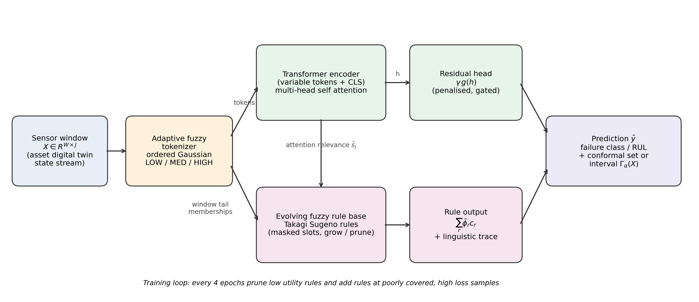

# NeuroFuzzFormer

Code, data and results for the paper

> **Evolving Neuro Fuzzy Transformer with Attention Driven Linguistic Hedges for Interpretable Asset Health Prediction**
> G. Arul Dalton and A. Ramachandran, Saveetha Engineering College, Chennai, India.
> Submitted to the *International Journal of Fuzzy Systems*.

NeuroFuzzFormer predicts machine failures and remaining useful life (RUL) with readable IF–THEN rules. Sensor readings are turned into fuzzy LOW / MEDIUM / HIGH tokens, a transformer reads the tokens, and its attention acts as a context dependent linguistic hedge ("very", "more or less") on the antecedents of an evolving Takagi–Sugeno rule base. Split conformal prediction adds calibrated prediction sets and intervals.



## Main results (five seeds, mean ± standard deviation)

| Task | NeuroFuzzFormer | Transformer | NeuralTSK (ANFIS style) | MLP | LSTM | HGB |
|---|---|---|---|---|---|---|
| AI4I 2020 failure F1 ↑ | **0.719 ± 0.085** | 0.720 ± 0.070 | 0.475 ± 0.065 | 0.592 ± 0.069 | – | 0.668 ± 0.096 |
| C-MAPSS FD001 RMSE ↓ (validation selected variant) | **12.73 ± 0.82** | 13.24 ± 0.27 | 17.86 ± 0.24 | 14.03 ± 0.58 | 13.90 ± 0.27 | 14.31 ± 1.05 |
| C-MAPSS FD003 RMSE ↓ (validation selected variant) | **13.20 ± 0.64** | 13.46 ± 0.45 | 19.34 ± 0.34 | 16.04 ± 1.26 | 15.93 ± 1.22 | 15.28 ± 0.66 |

On AI4I the rules alone reproduce 97.4% of the full model's decisions. All per run numbers are in `results/results.jsonl`; every table of the paper is regenerated by `scripts/analyze_results.py`.

## Repository layout

```
nff/                    the method
  data.py               loaders, splits and min-max normalisation (AI4I 2020, C-MAPSS FD001/FD003)
  models.py             fuzzy tokenizer, transformer, attention modulated TSK rule layer, baselines (JAX)
  train.py              training with rule evolution, metrics, split conformal calibration, CPU latency, HGB baseline
scripts/
  quick_run.py          train one model on one seed
  run_experiments.py    the full study of the paper (resumable)
  explain_rules.py      linguistic rules and an example explanation from the seed 0 model
  analyze_results.py    summary, validation selection, paired t tests and Tables 4–11
  make_figures.py       Figures 1–3
data/                   public datasets (see data/README.md for sources and licences)
results/                per run results and the aggregated tables used in the paper
checkpoints/            seed 0 NeuroFuzzFormer parameters for AI4I, FD001 and FD003
figures/                paper figures
```

## Installation

Python 3.10 or newer. Everything runs on a CPU; no GPU is needed.

```bash
git clone https://github.com/GArulDalton/neurofuzzformer.git
cd neurofuzzformer
python -m venv .venv && source .venv/bin/activate      # Windows: .venv\Scripts\activate
pip install -r requirements.txt
```

## Usage

```bash
# one model, one seed (about 1 minute on AI4I)
python scripts/quick_run.py ai4i ENFT 0
python scripts/quick_run.py FD001 ENFT-rawTokens 0

# reproduce the whole study (about 4 hours on one CPU core); results are appended to results/results.jsonl
python scripts/run_experiments.py
python scripts/run_experiments.py --data ai4i --seeds 0 1 2      # a subset

# rules, tables and figures
python scripts/explain_rules.py ai4i
python scripts/explain_rules.py FD001
python scripts/analyze_results.py
python scripts/make_figures.py
```

The repository already contains the results of the paper, so `analyze_results.py`, `explain_rules.py` and `make_figures.py` can be run immediately without retraining. Delete `results/results.jsonl` before `run_experiments.py` if you want to train from scratch.

### Model names

| Name in code | Name in the paper |
|---|---|
| `ENFT` | NeuroFuzzFormer (default, fuzzy augmented tokens) |
| `ENFT-rawTokens` | NeuroFuzzFormer with raw value tokens (validation selected on C-MAPSS) |
| `ENFT-noEvolve`, `ENFT-noAttnMod`, `ENFT-noResidual` | ablations in Table 9 |
| `Transformer`, `NeuralTSK`, `MLP`, `LSTM`, `HGB` | baselines |

### Settings used in the paper

Width 32, 2 layers, 4 heads, 3 linguistic terms, 32 rule slots with 8 initial rules, rule evolution every 4 epochs during the first 75% of training, AdamW (learning rate 2 × 10⁻³ with cosine decay, weight decay 5 × 10⁻⁴), batch size 256, 60 epochs for AI4I and 30 for C-MAPSS, λ_res = 0.01, λ_a = 10⁻³, conformal level α = 0.10. Splits: AI4I stratified 65/10/10/15 (train/validation/calibration/test); C-MAPSS training engines split 80/10/10 by engine and the official 100 test engines (last window, RUL capped at 125, window 30, 14 sensors). Seeds 0–4 change the split, initialisation and batch order.

## Reproducibility notes

The published numbers were produced on one core of an Intel Xeon CPU (2.8 GHz) with Python 3.12, JAX 0.12, Optax 0.2.8 and scikit-learn 1.8. Floating point results can differ slightly with other hardware or library versions; differences should be well inside the seed to seed standard deviations reported above.

## Citation

If you use this code, please cite the paper (citation details will be updated after publication):

```bibtex
@article{dalton2026neurofuzzformer,
  title   = {Evolving Neuro Fuzzy Transformer with Attention Driven Linguistic Hedges for Interpretable Asset Health Prediction},
  author  = {Dalton, G. Arul and Ramachandran, A.},
  journal = {International Journal of Fuzzy Systems},
  year    = {2026},
  note    = {Submitted}
}
```

## Licence

Code: MIT licence (see `LICENSE`). Datasets keep their original licences (see `data/README.md`).
